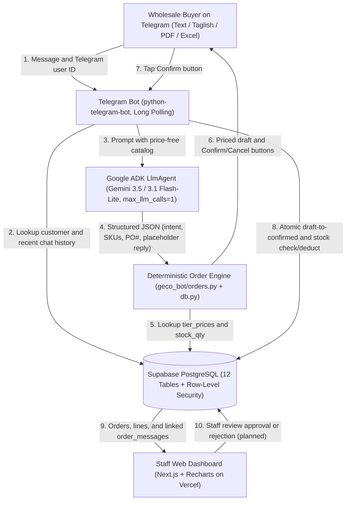

<div align="center">

# GECO Order Agent

**Automated wholesale order capture on Telegram—backed by deterministic tier pricing in Supabase and a Next.js staff inbox.**


[Overview](#overview) · [Order Experience](#order-experience) · [Architecture](#architecture) · [Design Guarantees](#design-guarantees) · [Catalog & Pricing Tiers](#catalog--pricing-tiers) · [Repository Layout](#repository-layout) · [Quick Start](#quick-start) · [Verification](#verification) · [Roadmap](#roadmap)

</div>

---

## Overview

Food and beverage wholesalers take orders all day through casual chat messages (in English and Taglish, such as `"pls send 3 ctn oat milk + 2 bags arabica tmr"`), spreadsheets, and hotel PDF purchase orders. Re-keying every message by hand leads to slow turnarounds, missed after-hours orders, and costly unit or tier-pricing mistakes.

**GECO Order Agent** meets wholesale buyers directly inside Telegram. It parses unstructured messages into catalog SKUs and quantities, prices every line deterministically in Python from PostgreSQL at the sender's contracted tier, replies in seconds with a one-tap **Confirm / Cancel** draft, deducts stock atomically on confirmation, routes short-stock or high-value orders into staff review, and links each order to the exact chat messages that created it.

> [!IMPORTANT]
> **AI reads, code prices.** Gemini never invents or computes prices, line totals, or stock figures. Even in natural-language Q&A replies, the model emits `{price:SKU}` and `{stock:SKU}` placeholders that Python resolves directly from `tier_prices` and `products.stock_qty` for the authenticated buyer's tier.

---

## Order Experience

Every interaction runs against the customer's registered Telegram account, catalog units, and contracted price tier:

**1. Messy free-text order (Café tier — list price)**

```text
Customer (Kapé Corner · Café tier):
  pls send 3 ctn oat milk + 2 bags arabica tmr

GECO Order Agent:
  Got it, I've drafted that order for you.

  Draft order:
  1. 3 x Oat Milk 1L (Carton of 12) @ $28.50 = $85.50
  2. 2 x House Espresso Arabica Beans (1 kg Bag) @ $24.00 = $48.00
  Total: $133.50
  Tap Confirm to place it or Cancel to drop it.

  [ Confirm ]  [ Cancel ]
```

**2. Tier-aware price & stock inquiry**

```text
Customer:
  how much is oat milk?

GECO Order Agent (Café · 0% off):
  Oat milk is $28.50 per Carton of 12.

GECO Order Agent (Hotel Chain · 10% off):
  Oat milk is $25.65 per Carton of 12.
```

**3. Short-stock detection & review hold (`5` trays of `DRY-EGG-30` remaining)**

```text
Customer:
  8 trays eggs

GECO Order Agent:
  Got it, here is your draft order.

  Draft order:
  1. 8 x Free-Range Large Eggs (Tray of 30) @ $9.60 = $76.80
     only 5 available, staff will check this line
  Total: $76.80
  Tap Confirm to place it or Cancel to drop it.

  [ Confirm ]  [ Cancel ]

Customer taps [ Confirm ] → Order moves to needs_review (review_reasons = ['stock']), stock stays at 5:
  Some items are short on stock, so our staff will check this order and get back to you.
```

<details>
<summary><strong>Supported message intents &amp; deterministic safeguards</strong></summary>

1. **Intents classified in a single turn:** `order`, `follow-up`, `question`, `price-list`, `chit-chat`, `abuse`, `spam`, `off-topic`, and `injection`.
2. **Full tier price list:** Asking for a price list without naming a product bypasses draft creation and renders every active SKU in the buyer's `tier_prices` table directly from SQL.
3. **Unmatched or wrong-unit lines:** If an item cannot be matched (`NO_MATCH`) or its extracted unit mismatches the SKU's catalog unit, `check_lines()` drops it and reports `"I couldn't match: ..."` instead of silently guessing.
4. **Idempotent buttons:** Confirming or cancelling updates `orders WHERE id = ... AND customer_id = ... AND status = 'draft'`. Tapping a stale button returns `"This order was already handled."`

</details>

---

## Architecture



### Tech Stack

| Layer | Stack | Why It Fits |
|---|---|---|
| **Bot & Runtime** | Python 3.12+, `python-telegram-bot` v22+ (long polling), `uv` | Runs cleanly from a local machine with zero public HTTPS webhook or server setup. |
| **AI Reader** | `google-adk`, `google-genai` (`gemini-3.5-flash-lite` primary, `gemini-3.1-flash-lite` fallback), Pydantic v2 | Single-turn structured output for intent classification, catalog SKU matching, PO number extraction, and placeholder replies. |
| **Database & Auth** | Supabase (PostgreSQL 18 compatible), Row-Level Security, `psycopg[binary,pool]` v3.2+ | Enforces strict customer scoping, atomic stock updates, and authenticated staff access. |
| **Document Parsing** | Gemini multimodal + `openpyxl` / `xlrd` | Packaged in `bot/` for upcoming PDF/photo purchase orders and `.xlsx`/`.xls` spreadsheets. |
| **Staff Dashboard** *(planned)* | Next.js (TypeScript), Recharts, `exceljs`, Supabase Auth, Vercel | Order inbox beside linked Telegram chats, review approvals, 4 shared-filter charts, and CSV/XLSX export. |

---

## Design Guarantees

Implemented across [bot/geco_bot/](bot/geco_bot) and [supabase/migrations/](supabase/migrations):

1. **Deterministic Tier Pricing** — Prices are queried from `tier_prices (tier_id, sku)` using `Decimal` arithmetic (`0.01` cent quantization). `products.list_price` is never used directly at order time, and the LLM system prompt contains SKU codes, names, units, and aliases—never prices.
2. **One Model Call per Message** — [reader.py](bot/geco_bot/reader.py) runs a tool-less Google ADK `LlmAgent` with a dynamically generated `Literal[...]` Pydantic `output_schema`, `temperature=0`, `ThinkingLevel.LOW`, `max_llm_calls=1`, exponential backoff retries (`attempts=4` on `429`/`503`), and automatic fallback from `gemini-3.5-flash-lite` to `gemini-3.1-flash-lite`.
3. **Strict Catalog & Unit Validation** — `check_lines()` verifies every returned SKU is active, `quantity > 0`, and `unit == product["unit_code"]`. Unmatched or unit-mismatched lines (`NO_MATCH`) are dropped and surfaced explicitly to the buyer.
4. **Confirm-Once & Guarded Stock Deduction** — `Database.confirm()` in [db.py](bot/geco_bot/db.py) updates `orders` only `WHERE id = %s AND customer_id = %s AND status = 'draft'` and deducts `products.stock_qty` inside a nested transaction (`WHERE p.stock_qty >= l.qty`). Duplicate taps return `"This order was already handled."`; short stock rolls back the deduction and places the order into `needs_review` with `review_reasons = ['stock']`.
5. **Order-to-Conversation Lineage** — `order_messages` links only the inbound messages, bot replies, and button presses belonging to a specific order, while `messages` preserves the complete chronological chat log (including non-order questions and failed reads).
6. **Customer Isolation & Hardened RLS** — Unregistered `telegram_user_id` senders receive a fixed rejection reply with zero database writes. All 12 tables enable Row-Level Security with `anon` revoked, scoped `authenticated` staff grants, a `NaN`/`Infinity`-safe non-negative stock constraint, and conversation-verified staff message linking.

---

## Catalog & Pricing Tiers

The synthetic dataset in [supabase/seed.sql](supabase/seed.sql) and [supabase/stock.sql](supabase/stock.sql) models a specialty food and beverage wholesaler with **40 active SKUs** across **5 categories** (`dairy`, `coffee_tea`, `dry_goods`, `sauces`, `packaging`), **7 units of measure** (`BTL`, `CTN12`, `BAG1KG`, `SACK5KG`, `TRAY30`, `PACK50`, `CASE6`), **120 pre-computed tier prices**, and **40 historical orders** across **40 conversations**.

| Tier ID | Tier Code | Display Name | Discount Off List | Seeded Accounts (Synthetic) |
|---:|---|---|---:|---|
| `1` | `cafe` | Café | `0.00%` | Kapé Corner, Third Wave Roastery, Morning Ritual Espresso |
| `2` | `restaurant_group` | Restaurant Group | `5.00%` | Bistro Verde Group, Saffron & Salt Kitchens, Harborfront Dining Co. |
| `3` | `hotel_chain` | Hotel Chain | `10.00%` | Harbourline Hotel Manila, Crestview Grand Hotels |

Several SKUs are intentionally seeded with low inventory in [supabase/stock.sql](supabase/stock.sql) (such as `DRY-EGG-30` at `5.00` trays and `COF-CHA-1K` at `6.00` cases) so short-stock review holds can be exercised out of the box.

---

## Repository Layout

```text
geco-order-agent/
├── .env.example                      # Required Telegram, Gemini, Supabase, and threshold config
├── scripts/
│   └── check-db.ps1                  # Ephemeral PostgreSQL 18 runner for migrations, seed, stock & RLS checks
├── supabase/
│   ├── migrations/
│   │   ├── 20261123000000_init.sql                    # 12 tables, order_status enum, indexes, RLS & grants
│   │   ├── 20261124000000_staff_order_message_links.sql # Scoped staff order_messages insert policy
│   │   └── 20261124000100_product_stock.sql           # products.stock_qty + NaN/Infinity guard + staff update policy
│   ├── seed.sql                      # 3 tiers, 7 units, 40 SKUs, 120 tier prices, 8 customers, 40 orders
│   ├── stock.sql                     # Initial stock_qty levels across all 40 SKUs
│   └── tests/
│       ├── stubs.sql                 # Minimal auth/role stubs for local standalone Postgres verification
│       └── check.sql                 # Schema, seed, stock constraint, and RLS/grant assertions
└── bot/
    ├── pyproject.toml                # geco-bot package & dependencies (uv / Python 3.12+)
    ├── geco_bot/
    │   ├── config.py                 # Loads environment variables from repo-root .env
    │   ├── db.py                     # psycopg connection pool, queries, atomic confirm & stock deduction
    │   ├── main.py                   # python-telegram-bot handlers & OrderBot orchestration
    │   ├── orders.py                 # Deterministic Decimal pricing, draft formatting & placeholder helpers
    │   └── reader.py                 # Google ADK LlmAgent, dynamic Pydantic schema, line check & fallback retry
    └── tests/
        ├── conftest.py               # Session-scoped throwaway Postgres template DB fixture
        └── test_core_loop.py         # Core loop, tier pricing, stock hold, idempotency & failure tests
```

---

## Quick Start

### Prerequisites

- **Python 3.12+** and [`uv`](https://docs.astral.sh/uv/)
- **PostgreSQL 18** (optional for cloud deployment; required locally to run `scripts/check-db.ps1` and `pytest`)
- A **Supabase** project (or local PostgreSQL instance)
- A **Telegram Bot token** from `@BotFather`
- A free-tier **Google AI Studio** API key

### 1. Configure Environment

Copy [.env.example](.env.example) to `.env` at the repository root and fill in your credentials:

```powershell
Copy-Item .env.example .env
```

| Variable | Description | Default / Example |
|---|---|---|
| `TELEGRAM_BOT_TOKEN` | Bot token from `@BotFather` | *(required)* |
| `GOOGLE_API_KEY` | Google AI Studio API key read by Google ADK | *(required)* |
| `GEMINI_MODEL` | Primary Gemini model ID | `gemini-3.5-flash-lite` |
| `GEMINI_FALLBACK_MODEL` | Secondary model ID used after retry exhaustion | `gemini-3.1-flash-lite` |
| `SUPABASE_DB_URL` | PostgreSQL connection string used by `geco_bot` | *(required)* |
| `SUPABASE_URL` | Supabase project URL for the dashboard | *(required for dashboard)* |
| `SUPABASE_PUBLISHABLE_KEY` | Supabase anon/publishable key for the dashboard | *(required for dashboard)* |
| `REVIEW_THRESHOLD_USD` | Order total above which orders route to staff review | `2000` |

### 2. Initialize Database & Map Your Telegram Account

Apply the three migrations in [supabase/migrations/](supabase/migrations) in timestamp order, then run [supabase/seed.sql](supabase/seed.sql) and [supabase/stock.sql](supabase/stock.sql). Finally, link your numeric Telegram user ID to one of the seeded customer accounts (such as `Kapé Corner`):

```sql
update customers
set telegram_user_id = <YOUR_TELEGRAM_USER_ID>
where name = 'Kapé Corner';
```

### 3. Run the Telegram Bot

```powershell
cd bot
uv sync
uv run python -m geco_bot.main
```

---

## Verification

Both verification suites spin up an isolated, throwaway PostgreSQL 18 instance on a random `127.0.0.1` port and delete the temporary data directory afterward—your cloud database is never touched.

- **Database migrations, seed, stock & RLS checks** (expects PostgreSQL 18 binaries at `C:\Program Files\PostgreSQL\18\bin`):

  ```powershell
  powershell -ExecutionPolicy Bypass -File scripts/check-db.ps1
  ```

  Healthy output ends with `CHECK-DB PASS`.

- **Bot test suite** (uses `PG_BIN` or defaults to `C:\Program Files\PostgreSQL\18\bin`):

  ```powershell
  cd bot
  uv run pytest
  ```

---

## Roadmap

- [x] Supabase PostgreSQL schema, Row-Level Security policies, 40-SKU catalog, 3-tier pricing, synthetic seed, and stock levels
- [x] Ephemeral PostgreSQL verification harness ([scripts/check-db.ps1](scripts/check-db.ps1) + [supabase/tests/check.sql](supabase/tests/check.sql))
- [x] Core Telegram text-order loop with Google ADK structured output, tier pricing, confirm/cancel, and `pytest` suite *(in progress on `feat/step-1-core-loop`)*
- [ ] Next.js staff dashboard: order inbox and full conversation monitor
- [ ] Interactive analytics (4 Recharts views, shared URL filters) and CSV/XLSX export on Vercel
- [ ] Open-draft conversational edits (`"make the oat milk 5"`) and staff hold/approval workflow (`REVIEW_THRESHOLD_USD` + short stock)
- [ ] Multimodal purchase order intake (PDF, photo, `.xlsx`, `.xls`)

---

<div align="center">

Built by **Ryan Dela Cruz** for **GECO Build Week (Solution 20 — Automated Order Management)**

100% free-tier and open-source tooling · Synthetic data only

</div>
