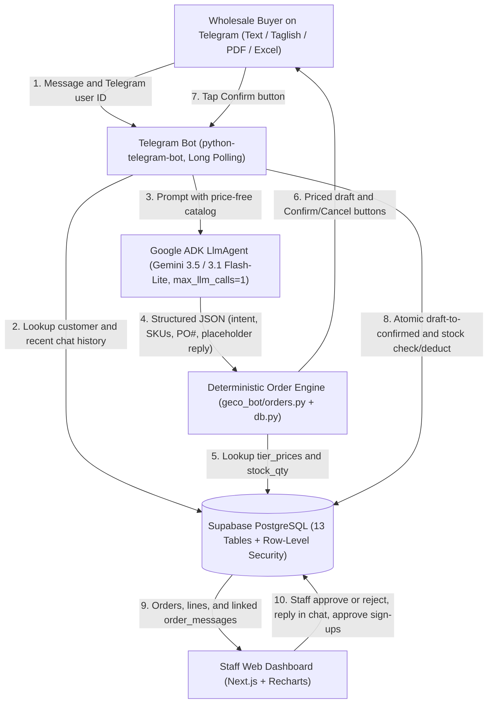

<div align="center">

# GECO Order Agent

**Automated wholesale order capture on Telegram—backed by deterministic tier pricing in Supabase and a Next.js staff inbox.**


[Overview](#overview) · [Order Experience](#order-experience) · [Architecture](#architecture) · [Design Guarantees](#design-guarantees) · [Catalog & Pricing Tiers](#catalog--pricing-tiers) · [Repository Layout](#repository-layout) · [Quick Start](#quick-start) · [Verification](#verification) · [Roadmap](#roadmap)

</div>

---

## Overview

Food and beverage wholesalers take orders all day through casual chat messages (in English and Taglish, such as `"pls send 3 ctn oat milk + 2 bags arabica tmr"`), spreadsheets, and hotel PDF purchase orders. Re-keying every message by hand leads to slow turnarounds, missed after-hours orders, and costly unit or tier-pricing mistakes.

**GECO Order Agent** meets wholesale buyers directly inside Telegram. It parses unstructured messages into catalog SKUs and quantities, prices every line deterministically in Python from PostgreSQL at the sender's contracted tier, replies in seconds with a one-tap **Confirm / Cancel** draft, deducts stock atomically on confirmation, routes short-stock or high-value orders into staff review, and links each order to the exact chat messages that created it.

New buyers start on the public **Iloilo Superb Mart** website: a landing page with a scannable Telegram QR code and a **Start on Telegram** button that opens the order bot (`@restock_gc_bot`), a walkthrough of how ordering works, a tier pricing demo, and a preview of the four sign-up questions the bot asks. Staff reach the Order Desk from the same site through **Staff sign in**.

> [!IMPORTANT]
> **AI reads, code prices.** Gemini never invents or computes prices, line totals, or stock figures. Even in natural-language Q&A replies, the model emits `{price:SKU}` and `{stock:SKU}` placeholders that Python resolves directly from `tier_prices` and `products.stock_qty` for the authenticated buyer's tier.

---

## Order Experience

Every interaction runs against the customer's registered Telegram account, catalog units, and contracted price tier:

**1. Messy free-text order (Café tier — list price)**

```text
Customer (Kapé Corner · Café tier):
  pls send 3 ctn oat milk + 2 bags arabica tmr

GECO Order Agent:
  Got it, here is your draft.

  Draft order

  1. Oat Milk 1L
     3 × Carton of 12 @ $28.50 = $85.50
  2. House Espresso Arabica Beans
     2 × 1 kg Bag @ $24.00 = $48.00
  ──────────
  Total: $133.50

  Tap Confirm to place it or Cancel to drop it.

  [ Confirm ]  [ Cancel ]

Customer taps [ Confirm ]:
  Order 3a7736d1 confirmed
  2 items · Total $133.50
  Thank you!

  [ Get receipt ]   → sends one PDF receipt, then the button is removed
```

**2. Tier-aware price & stock inquiry**

```text
Customer:
  how much is oat milk?

GECO Order Agent (Café · 0% off):
  Oat milk is $28.50 per Carton of 12.

GECO Order Agent (Hotel Chain · 10% off):
  Oat milk is $25.65 per Carton of 12.
```

**3. Short-stock detection & review hold (`5` trays of `DRY-EGG-30` remaining)**

```text
Customer:
  8 trays eggs

GECO Order Agent:
  Got it, here is your draft.

  Draft order

  1. Free-Range Large Eggs
     8 × Tray of 30 @ $9.60 = $76.80
     ⚠️ Only 5 available, staff will check this line
  ──────────
  Total: $76.80

  Tap Confirm to place it or Cancel to drop it.

  [ Confirm ]  [ Cancel ]

Customer taps [ Confirm ] → Order moves to needs_review (review_reasons = ['stock']), stock stays at 5:
  Our staff will check this order and get back to you.
```

**4. Editing an open draft**

```text
Customer (open draft: 3 ctn oat milk + 2 bags arabica):
  just the arabica, make it 4

GECO Order Agent:
  Removed from your draft: Oat Milk 1L

  Draft order

  1. House Espresso Arabica Beans
     4 × 1 kg Bag @ $24.00 = $96.00
  ──────────
  Total: $96.00

  Tap Confirm to place it or Cancel to drop it.

Customer taps [ Confirm ] on the older draft message:
  This draft has changed. Here is the latest one:
  (the current draft, with fresh buttons; nothing is confirmed)
```

<details>
<summary><strong>Supported message intents &amp; deterministic safeguards</strong></summary>

1. **Intents classified in a single turn:** `order`, `follow-up`, `question`, `price-list`, `chit-chat`, `abuse`, `spam`, `off-topic`, and `injection`.
2. **Full tier price list:** Asking for a price list without naming a product bypasses draft creation and renders every active SKU in the buyer's `tier_prices` table directly from SQL.
3. **Unmatched, wrong-unit or fractional lines:** If an item cannot be matched (`NO_MATCH`), its unit mismatches the SKU's catalog unit, or its quantity is not a whole number of units, `check_lines()` drops it and reports `"I couldn't match: ..."` instead of silently guessing.
4. **Idempotent buttons:** Confirming or cancelling updates `orders WHERE id = ... AND customer_id = ... AND status = 'draft'`. Tapping a button on an order that is already closed returns `"This order was already handled."`
5. **Versioned Confirm buttons:** Each Confirm button carries a fingerprint of the draft lines it showed (`confirm:<order id>:<8 hex>`). If the draft has been edited since, the tap confirms nothing and the bot resends the latest draft.
6. **Visible removals:** When an edit or replacement drops items, the reply starts with `"Removed from your draft: ..."`, so a misread edit is caught before Confirm.
7. **One open draft per chat:** Creating a draft closes any other open draft in the same chat in the same transaction, and the partial unique index `orders_one_open_draft` blocks a second one at the database level.
8. **Draft reminders:** Chit-chat or a question while a draft is open is answered, followed by `"You still have an open draft"` and the draft.
9. **Staff holds:** Orders over `REVIEW_THRESHOLD_USD`, short on stock, or with a quantity more than `QUANTITY_FACTOR` times the buyer's usual go to `needs_review` with every matching reason.
10. **Message screening:** Rule-based checks in [screen.py](bot/geco_bot/screen.py) hold injection, abuse, spam, repeats and floods for staff in the dashboard's Flagged view before any model call.

</details>

---

## Architecture



### Tech Stack

| Layer | Stack | Why It Fits |
|---|---|---|
| **Bot & Runtime** | Python 3.12+, `python-telegram-bot` v22+ (long polling), `uv` | Runs cleanly from a local machine with zero public HTTPS webhook or server setup. |
| **AI Reader** | `google-adk`, `google-genai` (`gemini-3.5-flash-lite` primary, `gemini-3.1-flash-lite` fallback), Pydantic v2 | Single-turn structured output for intent classification, catalog SKU matching, PO number extraction, and placeholder replies. |
| **Database & Auth** | Supabase (PostgreSQL 18 compatible), Row-Level Security, `psycopg[binary,pool]` v3.2+ | Enforces strict customer scoping, atomic stock updates, and authenticated staff access. |
| **Document Parsing** | Gemini multimodal + `openpyxl` / `xlrd` | Reads PDF and photo purchase orders and `.xlsx`/`.xls` spreadsheets into the same draft flow as text. |
| **Receipts** | `fpdf2` | One PDF receipt per confirmed order, sent on request in Telegram. |
| **Public Website** | Static HTML, CSS and JS in `dashboard/public/site/`, served at `/` by the Next.js middleware | Landing page for new buyers with the Telegram QR and sign-up preview; needs no build step and loads without a login. |
| **Staff Dashboard** | Next.js (TypeScript), Tailwind CSS, Recharts, `exceljs`, Supabase Auth + Realtime | Order inbox beside linked Telegram chats, review approvals, staff replies, inventory, flagged messages, sign-up approvals, 4 report charts, and Excel export. |

---

## Design Guarantees

Implemented across [bot/geco_bot/](bot/geco_bot) and [supabase/migrations/](supabase/migrations):

1. **Deterministic Tier Pricing** — Prices are queried from `tier_prices (tier_id, sku)` using `Decimal` arithmetic (`0.01` cent quantization). `products.list_price` is never used directly at order time, and the LLM system prompt contains SKU codes, names, units, and aliases—never prices.
2. **One Model Call per Message** — [reader.py](bot/geco_bot/reader.py) runs a tool-less Google ADK `LlmAgent` with a dynamically generated `Literal[...]` Pydantic `output_schema`, `temperature=0`, `ThinkingLevel.LOW`, `max_llm_calls=1`, exponential backoff retries (`attempts=4` on `429`/`503`), and automatic fallback from `gemini-3.5-flash-lite` to `gemini-3.1-flash-lite`.
3. **Strict Catalog & Unit Validation** — `check_lines()` verifies every returned SKU is active, the quantity is a whole number above `0`, and `unit == product["unit_code"]`. Unmatched or unit-mismatched lines (`NO_MATCH`) are dropped and surfaced explicitly to the buyer.
4. **Confirm-Once & Guarded Stock Deduction** — `Database.confirm()` in [db.py](bot/geco_bot/db.py) updates `orders` only `WHERE id = %s AND customer_id = %s AND status = 'draft'` and deducts `products.stock_qty` inside a nested transaction (`WHERE p.stock_qty >= l.qty`). Duplicate taps return `"This order was already handled."`; short stock rolls back the deduction and places the order into `needs_review` with `review_reasons = ['stock']`.
5. **Order-to-Conversation Lineage** — `order_messages` links only the inbound messages, bot replies, and button presses belonging to a specific order, while `messages` preserves the complete chronological chat log (including non-order questions and failed reads).
6. **Draft Integrity Without Trusting the Model** — One open draft per chat is enforced in `Database.create_draft()` and by the `orders_one_open_draft` partial unique index; a stale Confirm is refused by comparing the button's draft fingerprint inside the locked confirm transaction; confirmed and cancelled orders are labelled closed in the model's history so their items are not copied into new drafts.
7. **Customer Isolation & Hardened RLS** — Unregistered `telegram_user_id` senders can only start the sign-up flow, which staff approve in the dashboard before any order is taken. All 13 tables enable Row-Level Security with `anon` revoked, scoped `authenticated` staff grants, a `NaN`/`Infinity`-safe non-negative stock constraint, and conversation-verified staff message linking.

---

## Catalog & Pricing Tiers

The synthetic dataset in [supabase/seed.sql](supabase/seed.sql) and [supabase/stock.sql](supabase/stock.sql) models a specialty food and beverage wholesaler with **40 active SKUs** across **5 categories** (`dairy`, `coffee_tea`, `dry_goods`, `sauces`, `packaging`), **7 units of measure** (`BTL`, `CTN12`, `BAG1KG`, `SACK5KG`, `TRAY30`, `PACK50`, `CASE6`), **120 pre-computed tier prices**, and **40 historical orders** across **40 conversations**.

| Tier ID | Tier Code | Display Name | Discount Off List | Seeded Accounts (Synthetic) |
|---:|---|---|---:|---|
| `1` | `cafe` | Café | `0.00%` | Kapé Corner, Third Wave Roastery, Morning Ritual Espresso |
| `2` | `restaurant_group` | Restaurant Group | `5.00%` | Bistro Verde Group, Saffron & Salt Kitchens, Harborfront Dining Co. |
| `3` | `hotel_chain` | Hotel Chain | `10.00%` | Harbourline Hotel Manila, Crestview Grand Hotels |

Several SKUs are intentionally seeded with low inventory in [supabase/stock.sql](supabase/stock.sql) (such as `DRY-EGG-30` at `5.00` trays and `COF-CHA-1K` at `6.00` cases) so short-stock review holds can be exercised out of the box.

---

## Repository Layout

```text
geco-order-agent/
├── .env.example                      # Required Telegram, Gemini, Supabase, and threshold config
├── scripts/
│   └── check-db.ps1                  # Ephemeral PostgreSQL 18 runner for migrations, seed, stock & RLS checks
├── docs/
│   └── setup.md                      # Clean-clone setup, checks and troubleshooting
├── dashboard/                        # Next.js staff dashboard (reads dashboard/.env.local)
│   ├── middleware.ts                 # Login gate; serves the landing page at / to signed-out visitors
│   ├── public/site/                  # Public landing page (index.html, scrollcraft.css, scrollcraft.js)
│   ├── app/                          # orders, conversations, flagged, inventory, reports, signups, login, api/orders/export
│   ├── components/                   # App shell, charts, chat log, filters, live refresh, skeletons
│   └── lib/                          # Supabase client, Telegram sender, Excel export, formatting
├── supabase/
│   ├── migrations/                   # Schema, RLS & grants; apply every file in filename order
│   ├── seed.sql                      # 3 tiers, 7 units, 40 SKUs, 120 tier prices, 8 customers, 40 orders
│   ├── stock.sql                     # Initial stock_qty levels across all 40 SKUs
│   └── tests/
│       ├── stubs.sql                 # Minimal auth/role stubs for local standalone Postgres verification
│       └── check.sql                 # Schema, seed, stock constraint, and RLS/grant assertions
└── bot/
    ├── pyproject.toml                # geco-bot package & dependencies (uv / Python 3.12+)
    ├── geco_bot/
    │   ├── config.py                 # Loads environment variables from repo-root .env
    │   ├── db.py                     # psycopg connection pool, queries, atomic confirm & stock deduction
    │   ├── main.py                   # python-telegram-bot handlers & OrderBot orchestration
    │   ├── onboarding.py             # Telegram sign-up flow for unregistered buyers
    │   ├── orders.py                 # Deterministic Decimal pricing, draft formatting, draft fingerprint & removal note
    │   ├── reader.py                 # Google ADK LlmAgent, dynamic Pydantic schema, line check & fallback retry
    │   ├── receipt.py                # PDF receipts
    │   ├── screen.py                 # Rule-based screening before any model call
    │   └── screen_rules.json         # Injection, abuse and spam patterns
    └── tests/
        ├── conftest.py               # Session-scoped throwaway Postgres template DB fixture
        └── test_*.py                 # Core loop, draft guards, edits, holds, receipts, screening, onboarding & more
```

---

## Quick Start

For the full clean-clone walkthrough, checks and troubleshooting, see the [setup note](docs/setup.md).

**Free-tool stack:** Telegram Bot API, Supabase free tier, Google AI Studio free tier (no billing account) and GitHub, plus open-source Python, python-telegram-bot, Google ADK, psycopg, openpyxl, xlrd, fpdf2, Node.js, Next.js, React, Tailwind CSS, Recharts, ExcelJS and PostgreSQL.

### Prerequisites

- **Python 3.12+** and [`uv`](https://docs.astral.sh/uv/)
- **Node.js 22+** and npm (dashboard)
- **PostgreSQL 18** (optional for cloud deployment; required locally to run `scripts/check-db.ps1` and `pytest`)
- A **Supabase** project (or local PostgreSQL instance)
- A **Telegram Bot token** from `@BotFather`
- A free-tier **Google AI Studio** API key

### 1. Configure Environment

Copy [.env.example](.env.example) to `.env` at the repository root and fill in your credentials:

```powershell
Copy-Item .env.example .env
```

| Variable | Description | Default / Example |
|---|---|---|
| `TELEGRAM_BOT_TOKEN` | Bot token from `@BotFather` | *(required)* |
| `GOOGLE_API_KEY` | Google AI Studio API key read by Google ADK | *(required)* |
| `GEMINI_MODEL` | Primary Gemini model ID | `gemini-3.5-flash-lite` |
| `GEMINI_FALLBACK_MODEL` | Secondary model ID used after retry exhaustion | `gemini-3.1-flash-lite` |
| `SUPABASE_DB_URL` | PostgreSQL connection string used by `geco_bot` | *(required)* |
| `REVIEW_THRESHOLD_USD` | Order total above which orders route to staff review | `2000` |
| `QUANTITY_FACTOR` | A line more than this many times the buyer's usual quantity routes to staff review | `3` |
| `QUANTITY_MIN_HISTORY` | Past orders needed before the usual-quantity check applies | `2` |
| `POLL_SECONDS` | How often the bot checks for staff actions (released messages, rejects, receipts) | `5` |

### 2. Initialize Database & Map Your Telegram Account

Apply every file in [supabase/migrations/](supabase/migrations) in filename order, then run [supabase/seed.sql](supabase/seed.sql) and [supabase/stock.sql](supabase/stock.sql). Finally, link your numeric Telegram user ID to one of the seeded customer accounts (such as `Kapé Corner`):

```sql
update customers
set telegram_user_id = <YOUR_TELEGRAM_USER_ID>
where name = 'Kapé Corner';
```

### 3. Run the Telegram Bot

```powershell
cd bot
uv sync
uv run python -m geco_bot.main
```

### 4. Run the Staff Dashboard

The dashboard reads `dashboard/.env.local`, not the root `.env`. Create it with these variables:

| Variable | Description |
|---|---|
| `SUPABASE_URL` | Supabase project URL |
| `SUPABASE_PUBLISHABLE_KEY` | Supabase publishable key |
| `TELEGRAM_BOT_TOKEN` | Same bot token, used to send staff replies |

In Supabase Authentication, add a staff user and turn off public sign-ups. Then, in a second terminal from the repository root:

```powershell
cd dashboard
npm ci
npm run build
npm start
```

Open `http://localhost:3000`. Signed out, `/` shows the public landing page; **Staff sign in** at the top right opens `/login`, and **Back to website** under the sign-in card returns to the landing page. Signed in, `/` goes straight to Orders, so use a private window to view the landing page as a visitor. The staff screens are branded **Iloilo Superb Mart Order Desk**; receipts and the Excel export still name GECO Asia as the seller.

To host the dashboard on Vercel, set the project root to `dashboard` and add only the three variables above. The bot keeps running locally, since it uses long polling. Turn off public sign-up in Supabase Auth before the URL goes public, because every RLS policy trusts any signed-in user.

---

## Verification

Both verification suites spin up an isolated, throwaway PostgreSQL 18 instance on a random `127.0.0.1` port and delete the temporary data directory afterward—your cloud database is never touched.

- **Database migrations, seed, stock & RLS checks** (expects PostgreSQL 18 binaries at `C:\Program Files\PostgreSQL\18\bin`):

  ```powershell
  powershell -ExecutionPolicy Bypass -File scripts/check-db.ps1
  ```

  Healthy output ends with `CHECK-DB PASS`.

- **Bot test suite** (uses `PG_BIN` or defaults to `C:\Program Files\PostgreSQL\18\bin`):

  ```powershell
  cd bot
  uv run pytest
  ```

---

## Roadmap

- [x] Supabase PostgreSQL schema, Row-Level Security policies, 40-SKU catalog, 3-tier pricing, synthetic seed, and stock levels
- [x] Ephemeral PostgreSQL verification harness ([scripts/check-db.ps1](scripts/check-db.ps1) + [supabase/tests/check.sql](supabase/tests/check.sql))
- [x] Core Telegram text-order loop with Google ADK structured output, tier pricing, confirm/cancel, and `pytest` suite
- [x] Next.js staff dashboard: order inbox, live conversation monitor, staff replies, inventory, flagged messages and sign-up approvals
- [x] Reports (4 Recharts views) and Excel export
- [x] Open-draft conversational edits (`"make the oat milk 5"`) and staff hold/approval workflow (threshold, short stock, unusual quantity)
- [x] Multimodal purchase order intake (PDF, photo, `.xlsx`, `.xls`)
- [x] PDF receipts, reject notices, draft reminders and Telegram sign-up
- [x] Draft guards: one open draft per chat, versioned Confirm buttons, visible removals, whole units only
- [x] Public landing page with Telegram QR, served at `/` for signed-out visitors
- [ ] Website and dashboard hosted on Vercel
- [ ] Log every Gemini call to `model_calls` for cost and latency views

---

<div align="center">

Built by **Ryan Dela Cruz** for **GECO Build Week (Solution 20 — Automated Order Management)**

100% free-tier and open-source tooling · Synthetic data only

</div>
